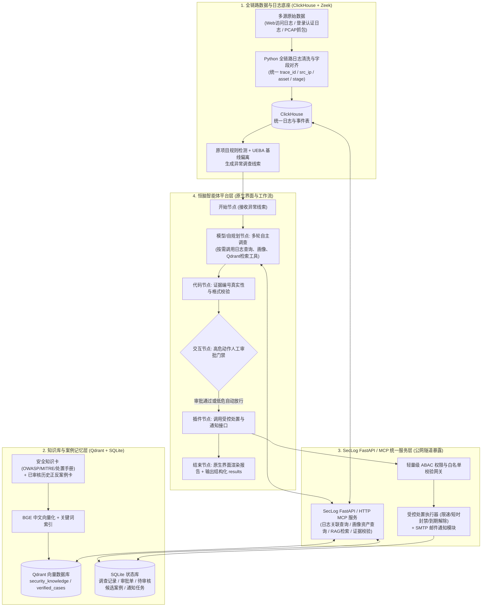

# SecLog-Agent 项目分工与前期架构设计说明书

## 一、 项目背景与技术路线决策

### 1.1 项目目标
本项目基于安恒恒脑安全智能体开发平台，复用并升级前期项目 [Dlalmlurn/log-ai-assistant](https://github.com/Dlalmlurn/log-ai-assistant) 的数据与后端底座，构建面向未预设异常场景的**自主安全日志调查与受控响应智能体（SecLog-Agent）**。核心能力涵盖：多源全链路日志接入与线索发现、Agent 多轮自主工具查证、RAG 安全知识与历史案例混合检索、基于权限边界的受控处置（自动限速/阻断与人工审批）、以及错题经验沉淀与独立评测回归。

### 1.2 核心技术路线调整
受限于硬件显存与算力条件，本项目**搁置针对大模型的监督微调（SFT）与强化学习训练**，基座大模型参数保持冻结，全面转向以下工程化技术路线：
1. **RAG 知识库混合检索**：基于 Qdrant 向量数据库与 BGE 中文向量模型，结合语义向量检索与关键词过滤，提供高准确率的 Web 安全知识与处置手册上下文。
2. **动态案例记忆沉淀**：将经过确认的历史调查记录划分为“正确案例”、“错误案例（含错误原因与正确修订方法）”与“待确认案例”，仅将审核通过的正反案例建入 Qdrant 索引，实现动态 Few-shot 经验复用与错题防重犯。
3. **提示词工程与程序强校验**：通过恒脑工作流节点编排、Guided JSON 强契约约束、思维链（CoT）引导及后端证据编号真实性校验，抑制模型幻觉并完成三轮可量化的迭代优化（V1 基线版 -> V2 知识库与受控处置版 -> V3 错题记忆反哺版）。

---

## 二、 前期架构设计与范围边界裁切

### 2.1 总体架构与链路设计



### 2.2 范围边界裁切原则（五保五砍）
为确保 6 人团队在 5 周周期内高质量完成开发并通过课题验收，严格执行以下边界管控：

| 维度 | 保留并深耕的核心内容（保） | 明确剔除或降级的内容（砍） |
| :--- | :--- | :--- |
| **1. 全链路日志底座** | 保留老项目 ClickHouse 存储、UEBA 基线（`src/ueba`）与检测规则（`src/detection`）；重点补齐 **Web日志 + 认证日志 + Zeek(PCAP)网络日志** 的全链路字段对齐与攻击故事链串联，以及 **Agent 调查运行轨迹日志（Trace Log）** 归档。 | 不重写 Flink/Kafka 底层流引擎，新增多源日志与 PCAP 解析直接通过标准化 Python 脚本清洗入库。 |
| **2. 交互界面与产品对接** | **直接使用恒脑平台【我的智能体】原生调试/对话界面 + 原生【交互节点】问答中断**展示调查过程、发起人工审批并输出 Markdown 报告；通过平台 `/open/api/v2/agent/execute` 与 `/execute/resume` 实现外部联动。 | **彻底砍掉老项目 React 前端开发**；不对接安恒商业硬件专用的私有接口（如商业关保态势感知一体机）。 |
| **3. MCP 与 API 工具层** | 统一由后端 **SecLog FastAPI / HTTP MCP 服务**封装所有查询与业务能力，经内网穿透（natfrp）向恒脑云端提供标准 HTTPS 接口。 | 不分散维护多个独立开源本地 stdio MCP 进程（恒脑 SaaS 云端无法直连本地 stdio 进程）。 |
| **4. 权限控制与受控处置** | 采用 **FastAPI 内置 Python 权限校验函数 + YAML 白名单配置 + SQLite 审批表**，实现低危动作自动执行、高危动作走恒脑【交互节点】或邮件审批、到期自动解除。 | **砍掉独立的 OPA（Open Policy Agent）策略服务**，避免引入冗余运维复杂度。 |
| **5. 知识库、通知与评测** | 部署 Qdrant + BGE 混合检索；通知渠道主攻 **SMTP HTML 邮件**；评测集标准答案（Ground Truth）与 Agent 可检索的 Qdrant 集合严格物理隔离。 | 钉钉企业应用审批降为可选扩展；严禁未经审核的候选案例自动写入 Qdrant 正式检索库。 |

---

## 三、 六人团队职责分工与目录边界

### 3.1 人员角色与核心分工总表

| 成员 (GitHub ID) | 角色分组 | 核心负责模块 | 代码与文档归属目录 |
| :--- | :--- | :--- | :--- |
| **李 (`@lizhikeer`)** | 核心骨干组 | 1. GitHub 仓库治理、分支保护、Issue 统筹与全员 PR 终审合并<br/>2. 服务器/NAS 容器运维（ClickHouse、Qdrant、FastAPI）与公网穿透隧道保障<br/>3. 流量抓包（PCAP/Zeek）、真实日志采集接入与老项目检测底座维护<br/>4. 受控处置网关（白名单/ABAC 校验、阻断执行器、到期自动解除） | `.github/`、`docker/`、`src/storage/`、`src/detection/`、`src/ueba/`、`src/operations/response_executor.py` |
| **`@Snowed-night`** | 核心骨干组 | 1. Qdrant 向量数据库部署对接与 BGE 中文向量模型混合检索（语义 + 关键词）实现<br/>2. 安全知识库（`security_knowledge`）与历史案例库（`verified_cases`）Schema 设计与入库管线<br/>3. 候选案例存储（SQLite）、人工确认后转入正式索引、错误案例修订卡检索逻辑<br/>4. 独立评测集与 Agent 检索库的防泄漏隔离机制 | `src/knowledge/`、`src/memory/`、`scripts/ingest_knowledge.py` |
| **`@chensz-u`** | 核心骨干组 | 1. 恒脑平台智能体工作流编排（开始节点、代码节点、模型/自规划节点、交互节点、结束节点）<br/>2. SecLog FastAPI / MCP 工具服务封装（日志关联查询、画像查询、资产上下文、处置申请、案例提交接口）<br/>3. Agent 多轮自主调查控制逻辑、模型自检与后端证据编号真实性校验<br/>4. System Prompt 工程与 V1/V2/V3 三轮迭代调优 | `src/api/`、`src/mcp_server/`、`src/ai_engine/`、`design/hengnao_workflows/` |
| **`@ribbonfish-jun`** | 核心支援 A 组<br/>（全链路日志工程） | 1. **多源日志清洗与字段标准化**：编写 Python 脚本将 Web 访问日志、认证日志、Zeek 网络日志转换为统一 Schema<br/>2. **全链路攻击故事日志包构造**：按“扫描探测 -> 认证爆破 -> 漏洞利用 -> 异常外连”串联多阶段关联日志并标注标准证据链<br/>3. **Agent 运行轨迹（Trace Log）归档**：收集整理恒脑平台每次多轮调查的完整工具调用与推理轨迹 JSON | `data/full_chain_logs/`、`data/agent_traces/`、`scripts/log_cleaners/` |
| **`@Tr4cy-cyber`** | 核心支援 B 组<br/>（RAG 知识与案例卡片） | 1. **安全知识卡批量构建**：将 OWASP Web 安全指南、MITRE ATT&CK 技术特征、本站处置手册按固定 JSON/Markdown 模板结构化（50+ 张）<br/>2. **正反案例与错题修订卡整理**：配合 `@Snowed-night` 将确认的正确调查案例及评测错题（含错误原因与正确修订方案）整理为标准卡片 | `data/knowledge_cards/`、`data/case_memories/` |
| **`@zyh060911`** | 核心支援 C 组<br/>（通知、算分与迭代台账） | 1. **SMTP 邮件通知模块**：编写独立的 Python SMTP 发信函数与 HTML 告警/审批邮件渲染模板<br/>2. **自动化评测算分脚本**：编写 `scripts/eval_runner.py`，自动比对 Agent 输出 JSON 与标准答案 JSON，计算诊断准确率、证据支持率、处置正确率<br/>3. **三轮迭代优化台账与答辩文档**：按课题五要素规范记录 V1->V2->V3 优化过程与指标对比表 | `src/operations/email_notifier.py`、`scripts/eval_runner.py`、`docs/iterations/` |

---

## 四、 五周推进里程碑计划（W1 ~ W5）

| 周次 | 里程碑目标 | `@lizhikeer` | `@Snowed-night` | `@chensz-u` | `@ribbonfish-jun` (A: 全链路日志) | `@Tr4cy-cyber` (B: 知识与案例卡) | `@zyh060911` (C: 通知/算分/台账) |
| :--- | :--- | :--- | :--- | :--- | :--- | :--- | :--- |
| **第 1 周** | 底座容器就绪、公网连通、四大 JSON 契约冻结、首轮数据与工具骨架落地 | 迁移老项目后端骨架；拉起 ClickHouse/Qdrant/FastAPI 容器与公网隧道；制定全链路日志 Schema 并审批首轮 PR | 部署连接 Qdrant 并跑通 BGE 向量化；冻结知识卡与案例卡 Schema；完成批量入库脚本骨架 | 搭建 SecLog FastAPI 工具层骨架并在恒脑平台完成 `/health` 调试 200；搭建恒脑工作流初版骨架；冻结 Agent 输出 Schema | 编写 Nginx/Auth/Zeek 多源日志转统一 Schema 的 Python 清洗脚本；提交首组 3 个全链路攻击场景日志样例 | 按固定 Schema 生成首批 20 张 Web 安全与处置手册知识卡（覆盖 SQLi/XSS/暴破/上传/遍历） | 编写独立 SMTP 邮件发送函数与 HTML 告警邮件模板并完成发信自测；初始化迭代记录文档框架 |
| **第 2 周** | 全链路日志入库、RAG 混合检索上线、V1 基线版 Agent 跑通闭环 | 接入服务器真实访问/抓包 Zeek 日志入 ClickHouse；调通老项目规则检测与 UEBA 异常线索接口 | 实现 Qdrant 向量+关键词混合检索接口 `/rag/search`；将首批知识卡灌入 Qdrant | 封装日志关联查询、画像查询、资产上下文工具并注册至恒脑；跑通 **V1 基线版 Agent** 多轮查证 | 构造 10 组完整全链路攻击故事日志包（含正常背景流量）及配套「标准证据链答案卡」 | 生成第二批 20 张 MITRE ATT&CK 常见攻击特征与排查方法知识卡；核验知识卡元数据 | 编写 `scripts/eval_runner.py` 自动算分脚本，支持对比 Agent 输出与标准答案并生成 Markdown 统计表 |
| **第 3 周** | 受控处置与交互审批打通、案例记忆沉淀上线、发布 V2 版 Agent | 实现 FastAPI 权限/白名单校验、限速/封禁执行器与到期自动解除；联调恒脑【交互节点】`/execute/resume` | 实现候选案例存 SQLite 及审核后写入 Qdrant `verified_cases`；支持正确案例与错误修订卡分类检索 | 接入 RAG 检索工具、【交互节点】审批门禁与处置插件；增加证据 ID 真实性程序校验，发布 **V2 版 Agent** | 构造 10 组进阶/混淆全链路日志场景（含慢速攻击、合法运维误报场景）；归档 V1/V2 Agent 运行 Trace 日志 | 将前两周确认的调查记录和典型误判整理为 15 张标准案例卡与错题修订卡 | 将 SMTP 邮件模块接入告警与审批任务流；运行 V1 vs V2 算分对比，产出《第 1 轮迭代优化记录》 |
| **第 4 周** | 错题反哺调优、独立评测集全量回归、发布 V3 版 Agent | 组织真实抓包流量下的端到端攻防演练（注入未预设异常场景）；检验自动处置与到期解除稳定性 | 将 V2 评测暴露的漏报/误判转化为纠错知识卡入库；调优检索权重并验证评测集零泄漏 | 优化 System Prompt（强约束全链路查证深度、停止条件与未知事项声明）；发布 **V3 版 Agent** | 汇总冻结 30+ 组高质量全链路日志数据集（划分开发集与独立评测集），归档 V3 运行 Trace 日志 | 补齐 50+ 张安全知识卡与正反案例库，完成全量标签与有效期校验 | 运行 V2 vs V3 独立评测集回归算分，生成三轮指标对比图表，完成《第 2、3 轮迭代优化记录》 |
| **第 5 周** | 代码封版 Release、“2正常+1异常”现场演练与答辩交付 | 终审合并全员 PR 并发布 GitHub Release；保障演示环境与隧道稳定 | 导出知识库与案例库快照及检索命中率实验数据 | 冻结恒脑平台 V3 最优配置，演练“2 正常 + 1 异常”实时流式调查与交互审批 | 编写《全链路日志数据集说明文档》，准备现场演示投喂的黄金日志样本 | 编写《RAG 知识库与案例记忆沉淀说明文档》 | 汇编《最终验收报告》《三轮优化记录完整台账》与答辩演示材料 |

---

## 五、 核心数据契约规范（Week 1 冻结基准）

### 5.1 全链路日志统一字段规范（Unified Log Schema）
所有清洗后的 Web 访问日志、认证日志与 Zeek 网络日志均需对齐为以下核心字段结构（JSON Lines 格式）：
```json
{
  "log_id": "LOG-20261027-0001",
  "trace_id": "CHAIN-ATTACK-01",
  "timestamp": "2026-10-27T14:20:05Z",
  "log_source": "nginx_access | auth_log | zeek_conn | zeek_http",
  "src_ip": "198.51.100.23",
  "src_port": 54321,
  "dest_ip": "10.0.0.15",
  "dest_port": 443,
  "asset_id": "web-prod-01",
  "user": "admin",
  "session_id": "sess-9f8a7b",
  "action_Or_method": "POST",
  "uri_or_target": "/admin/login.php",
  "payload_summary": "username=admin&password=' OR 1=1--",
  "status_code": 200,
  "bytes_out": 4520,
  "user_agent": "sqlmap/1.7.2",
  "attack_stage_hint": "recon | brute_force | exploitation | c2_callback | benign"
}
```

### 5.2 安全知识卡与纠错案例卡规范（Knowledge & Case Card Schema）
```json
{
  "card_id": "KB-OWASP-SQLI-001",
  "card_type": "security_knowledge | verified_correct_case | verified_error_revision",
  "title": "SQL 注入攻击（联合查询与写文件 Webshell）调查与处置指南",
  "attack_category": "SQL_Injection",
  "mitre_id": "T1190",
  "applicable_log_sources": ["nginx_access", "zeek_http", "auth_log"],
  "key_indicators": [
    "URI 或请求体包含 UNION SELECT、INTO OUTFILE、sleep()、information_schema",
    "同一源 IP 短时间内触发大量 500/403 状态码后突然出现 200 且响应包体异常增大"
  ],
  "investigation_steps": [
    "步骤 1：查询该 src_ip 在过去 1 小时内的全部 Web 访问日志，确认是否存在前置目录扫描或参数遍历",
    "步骤 2：检查响应状态码为 200 的请求字节数（bytes_out）及后续是否有针对新生成脚本路径（如 .php）的访问",
    "步骤 3：关联查询 Zeek 网络流日志，确认受影响资产是否发起异常外连（C2 回连）"
  ],
  "recommended_action": "block_ip_short_term",
  "error_revision_note": "（仅错误案例卡填写）原判读仅看到 200 状态码即判定注入成功，忽略了响应体实为统一错误页；需结合 bytes_out 与后续行为二次确认。",
  "source_reference": "OWASP SQL Injection Prevention Cheat Sheet",
  "review_status": "approved"
}
```

### 5.3 Agent 结构化输出与评测真值规范（Evaluation & Output Schema）
```json
{
  "case_id": "EVAL-CHAIN-001",
  "is_malicious": true,
  "attack_type": "SQL_Injection_After_Brute_Force",
  "risk_level": "HIGH",
  "attacker_ip": "198.51.100.23",
  "victim_asset": "web-prod-01",
  "evidence_log_ids": [
    "LOG-20261027-0001",
    "LOG-20261027-0008",
    "LOG-20261027-0015"
  ],
  "attack_chain_summary": "攻击源 198.51.100.23 先对 /admin 执行账号爆破失败，随后针对登录接口发起 SQL 注入绕过认证并尝试导出敏感表数据。",
  "recommended_action": "block_ip",
  "requires_human_approval": true,
  "unknown_items": "暂未获取到数据库内部审计日志，需进一步确认敏感表具体泄露行数。"
}
```

---

## 六、 GitHub 分支管理与 PR 审批流程

1. **分支隔离规范**：`main` 分支受保护，严禁直接 Push。所有成员开发时必须从最新 `main` 切出独立分支（如 `feature/log-cleaner`、`docs/kb-batch-1`、`feature/smtp-notifier`）。
2. **目录边界约束**：每位成员仅修改各自归属目录下的文件，严禁跨目录修改他人模块代码或上传敏感密钥（`.env`、邮箱授权码、API Key 必须通过环境变量读取）。
3. **PR 审查与合并**：提交 Pull Request 后，统一由仓库维护者 `@lizhikeer` 进行代码规范、Schema 合规性与目录边界审查，至少 1 个 Approve 后合并入 `main`。
