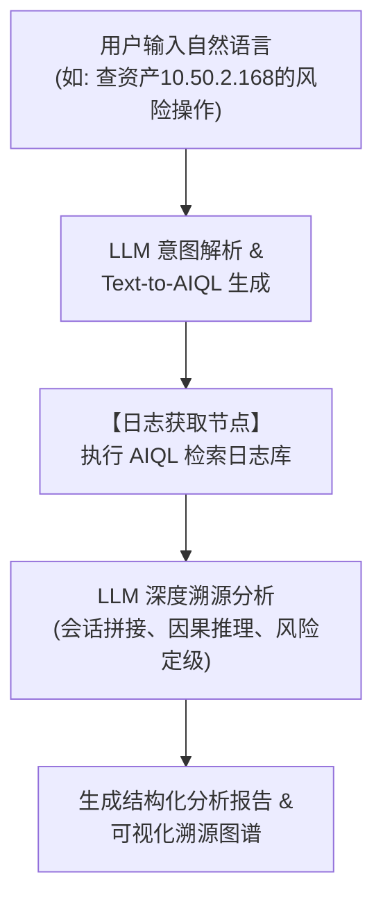
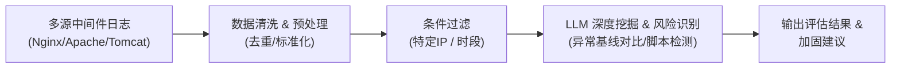
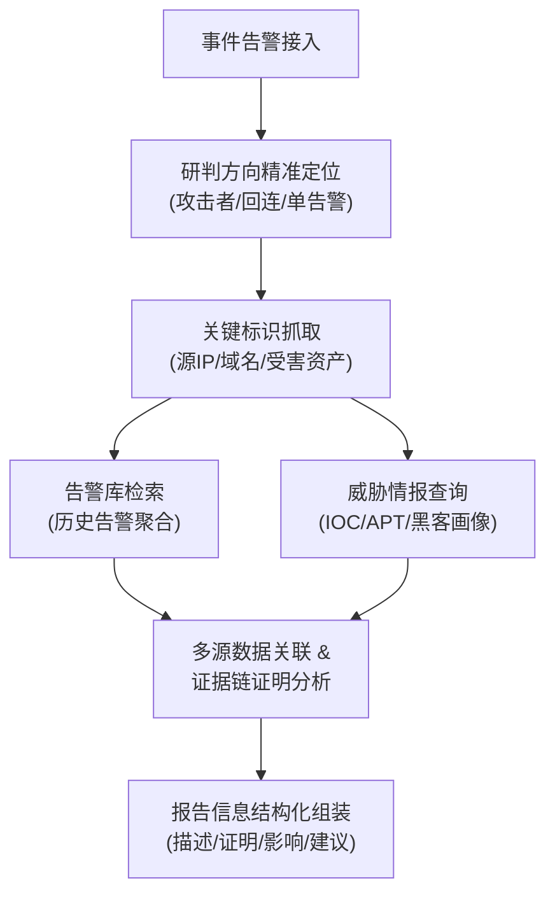
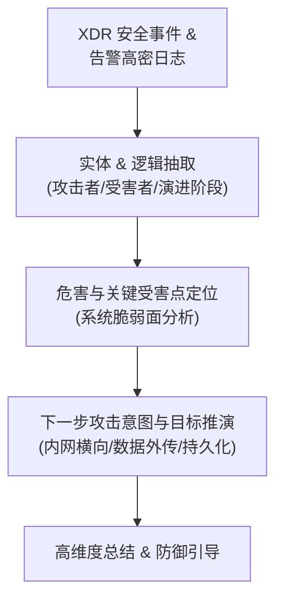
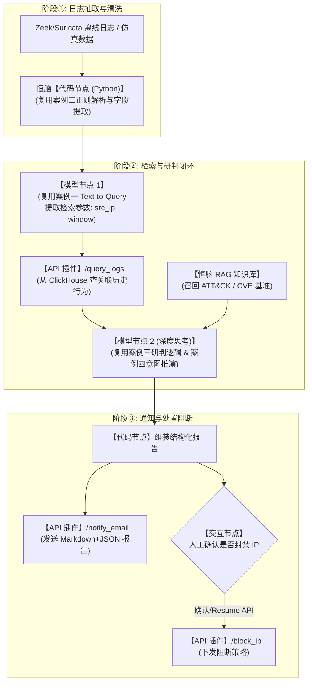

# 恒脑平台官方参考智能体深度技术解析（LLM工程参考版）

> **文档定位**：本文档基于恒脑平台官方发布的 4 大标杆安全智能体白皮书与使用手册进行深度逆向与技术解析。提炼出完整的**业务架构、数据输入/输出契约（Schema）、Prompt 推理逻辑、Text-to-Query（AIQL）检索语法、多源数据关联规则、研判报告结构**以及面向自建“日志抽取 $\rightarrow$ 研判检索 $\rightarrow$ 通知处置”智能体的最佳实践模板，供大模型与研发团队直接参考复用。

---

## 目录
1. [官方参考智能体全景对比矩阵](#1-官方参考智能体全景对比矩阵)
2. [案例一：堡垒机日志智能溯源分析智能体（Text-to-Query + 深度溯源）](#2-案例一堡垒机日志智能溯源分析智能体)
3. [案例二：事件调查日志分析智能体（中间件/Web 访问日志挖掘）](#3-案例二事件调查日志分析智能体)
4. [案例三：事件研判智能体（三大研判方向 + 多源关联证据链）](#4-案例三事件研判智能体)
5. [案例四：XDR 安全事件解读智能体（攻击过程还原 + 下一步意图推演）](#5-案例四xdr-安全事件解读智能体)
6. [自研智能体工程落地映射与组件复用指南](#6-自研智能体工程落地映射与组件复用指南)

---

## 1. 官方参考智能体全景对比矩阵

| 维度 | 1. 堡垒机日志智能溯源分析智能体 | 2. 事件调查日志分析智能体 | 3. 事件研判智能体 | 4. XDR 安全事件解读智能体 |
| :--- | :--- | :--- | :--- | :--- |
| **版本号** | V1.12.0 | V1.0.0 | V4.0.2 | V1.0.0 |
| **核心业务场景** | 运维审计、内网越权/违规操作排查、资产入侵溯源 | Web 中间件日志深度挖掘、异常访问检测、漏洞探测识别 | 重大安全事件研判、虚假告警过滤、攻击证据链闭环 | 高密度 XDR 事件降维解读、攻击演进分析、意图推演 |
| **输入数据类型** | 自然语言溯源指令 + 目标资产/用户 + 时间段 | 原始 Web/中间件日志文本（Nginx/Apache/Tomcat 格式） | 关键基础设施平台告警元数据（告警ID、IP、域名） | XDR 聚合安全事件日志 + 关联告警列表 |
| **外部数据检索** | 堡垒机日志数据库（通过大模型生成 AIQL 检索） | 预置日志样本或外部中间件日志存储库 | 内部告警数据库 + **外部威胁情报中心（IOC/APT）** | XDR 事件关联数据库 |
| **核心大模型任务** | ① 自然语言 $\rightarrow$ AIQL 语句转换<br/>② 会话行为轨迹关联推理<br/>③ 风险评级与溯源图谱生成 | ① 访问基线对比与异常挖掘<br/>② 攻击特征匹配与自动化脚本识别<br/>③ 安全隐患综合评估 | ① 研判方向自动分类<br/>② 内部告警与威胁情报关联<br/>③ 真实性证明与结构化报告生成 | ① 攻击者/受害者实体抽取<br/>② 关键受害点定位<br/>③ 下一步攻击目标与意图推演 |
| **主要输出物** | 包含操作链路、风险评级依据与处置建议的 JSON/Markdown + 可视化溯源图 | 访问统计、风险行为分布、溯源结论与加固建议 | 单告警/攻击者/回连三类标准化结构化研判报告 | 攻击全过程摘要、危害评级、下一步防御建议 |

---

## 2. 案例一：堡垒机日志智能溯源分析智能体

### 2.1 业务流程与架构拓扑


### 2.2 核心数据契约（Schema 细节）

#### (1) 日志检索节点入参 Schema（大模型生成的 AIQL 结构）
大模型将用户的自然语言需求转换为结构化查询参数：
```json
{
  "descAnalysis": "用户希望获取与资产'10.50.2.168'相关的风险溯源分析，可能包括访问该资产的用户行为、操作记录、命令执行情况以及文件传输活动，以识别潜在的安全威胁或异常行为。",
  "startTime": "2026-04-17 00:00:00",
  "endTime": "2026-04-17 16:47:51",
  "viewType": "asset",
  "eventTypeList": ["command", "file"],
  "eventLogAiqlStr": "deviceSendProductName == \"明御运维审计与风险控制系统\" AND logType in [${logType}] AND sessionId == ${sessionId} AND database != \"alert\" AND (destHostName in ['10.50.2.168'] OR (destServiceName in ['10.50.2.168'] OR destAddress in ['10.50.2.168']))",
  "optLogAiqlStr": "deviceSendProductName == \"明御运维审计与风险控制系统\" AND logType == \"system_operation\" AND srcAddress exist AND srcUserName exist AND (destHostName in ['10.50.2.168'] OR (destServiceName in ['10.50.2.168'] OR destAddress in ['10.50.2.168']))",
  "sessionLogAiqlStr": "deviceSendProductName == \"明御运维审计与风险控制系统\" AND logType == \"traffic\" AND logType != \"alert\" AND (destHostName in ['10.50.2.168'] OR (destServiceName in ['10.50.2.168'] OR destAddress in ['10.50.2.168']))"
}
```

> **AIQL 语法规范提炼**：
> - 字段布尔匹配：`==`、`!=`、`in [...]`、`exist`。
> - 逻辑组合：`AND`、`OR`，支持括号优先级。
> - 动态占位符：`${logType}`、`${sessionId}`，供工作流在二阶段查询时填充。

#### (2) 日志检索节点返回数据格式（供大模型分析的会话上下文）
```json
{
  "descAnalysis": "...",
  "optLogs": {},
  "sessionsInfo": {
    "9b49ad31694a4ed00000000001000002": {
      "type": 0,
      "data": {
        "sessionId": "9b49ad31694a4ed00000000001000002",
        "deviceName": "明御运维审计与风险控制系统",
        "srcAddress": "10.11.45.58",
        "destAddress": "10.50.2.168",
        "assetIpList": ["10.50.2.168_database"],
        "srcUserName": "test",
        "userName": "test",
        "userIp": "10.11.45.58",
        "ruleType": "/DataSteal/DatabaseDump",
        "threatLevel": "高风险",
        "threatName": "MySQL 注入攻击尝试",
        "time": {
          "startTime": "2026-04-16 00:00:00",
          "endTime": "2026-04-16 23:16:20"
        },
        "analysis": "## 操作行为分析\n 用户 test 通过 MySQLWorkbench 客户端，持续尝试执行恶意 SQL 语句 select \"<?php @eval($_POST['cmd']); ?>\" into outfile \"/var/www/html/shell.php\"，意图将 PHP Webshell 写入 Web 目录。该操作在 24 小时内重复执行超过 30次，且每次执行均因 MySQL 的--secure-file-priv 限制而失败。\n\n## 风险评级依据\n1. 高风险特征匹配：\n - 用户行为符合高风险操作中“上传脚本或程序文件后立即执行，但脚本来源不明、命名随机”的特征。尽管脚本未成功写入，但其内容为典型的 Webshell 代码，意图实现远程代码执行。\n - 操作具有明显的攻击性，且重复频率高，表明攻击者可能在尝试绕过安全限制。\n\n2. 行为异常性：\n - 用户 test 在无任何前置查询或配置检查的情况下，直接尝试写入 Webshell，不符合常规运维行为逻辑。\n - 操作目标路径/var/www/html/shell.php 为 Web 服务目录，表明攻击者意图通过 Web 访问执行恶意代码。\n\n3. 系统安全影响：\n - 若攻击成功，将导致服务器被远程控制，可能引发数据泄露、系统破坏等严重后果。\n - 该行为表明攻击者已掌握数据库访问权限，且试图扩展攻击面，需立即阻断并调查攻击来源。\n\n## 综合结论\n 用户 test 的行为构成高风险攻击尝试，建议立即阻断其访问权限，并对相关账号、IP 地址进行溯源分析，以防止潜在的横向移动或数据泄露风险。"
      }
    },
    "eafdff0669525719880000000001000002": {
      "type": 0,
      "data": {
        "sessionId": "eafdff0669525719880000000001000002",
        "deviceName": "明御运维审计与风险控制系统",
        "srcAddress": "10.11.45.58",
        "destAddress": "10.50.2.168",
        "srcUserName": "test",
        "threatLevel": "中风险",
        "threatName": "用户批量查询敏感业务表数据",
        "analysis": "## 操作行为分析\n 用户 test 通过 MySQLWorkbench 和 mysqldump 工具，连续执行了多个 SELECT 语句，批量查询了多个敏感业务表（包括 t_waf_block、t_edr_asset_bug、t_role、t_license 等20余张表）。\n\n## 风险评级依据\n1. 批量查询多个敏感业务表：超出常规故障排查范围。\n2. 使用 mysqldump 工具：通过 SELECT 语句批量提取数据，涉及数据聚合或泄露风险。\n3. 无前置检查行为：直接进行批量查询。\n\n## 风险事件总结\n 判定为中风险，存在信息泄露或数据聚合的潜在风险。"
      }
    }
  }
}
```

### 2.3 研判推理思维链（CoT）三段式范式
官方给出的标准提示词与思维模板分为三层：
1. **操作行为分析（Behavior Analysis）**：
   - 提取实体：操作账号、工具客户端、目标库/表/系统路径。
   - 行为特征：执行动作（写入、读取、导出）、命令/SQL 语法内容、执行频次与时间窗口、执行结果（成功/失败原因）。
2. **风险评级依据（Risk Rating Criteria）**：
   - 规则匹配：高风险特征（如 Webshell 注入、特权提升）、中风险特征（批量拖库、未授权信息聚合）。
   - 异常偏离：无前置业务动作、不合逻辑的运维习惯。
   - 影响推演：成功后的危害（提权、远程代码执行 RCE、横向移动）。
3. **综合结论与处置建议（Disposition & Action）**：
   - 明确威胁等级（高/中/低危）。
   - 给出即刻处置动作（阻断访问权限、隔离账号、加固 MySQL 配置）。

---

## 3. 案例二：事件调查日志分析智能体

### 3.1 业务流程与架构拓扑
面向海量 Web 服务器日志（Nginx / Apache / IIS），实现基于日志文本切片的直接分析。



### 3.2 典型输入日志数据格式（真实样本）
标准 Nginx Combined Log 格式：
```text
123.125.71.111 - - [06/Dec/2014:06:25:43 +0800] "-" 408 0 "-" "-"
180.76.15.146 - - [06/Dec/2014:06:48:33 +0800] "GET / HTTP/1.1" 200 10604 "-" "Mozilla/5.0 (compatible; Baiduspider/2.0; +http://www.baidu.com/search/spider.html)"
104.131.85.150 - - [06/Dec/2014:09:47:17 +0800] "GET / HTTP/1.1" 301 556 "-" "curl/7.35.0"
221.224.195.254 - - [06/Dec/2014:10:29:27 +0800] "GET /img/logo.png HTTP/1.1" 200 4522 "http://www.simplecloud.cn/simplelab.html" "Mozilla/5.0 (Windows NT 6.1; WOW64)"
183.11.76.8 - - [06/Dec/2014:20:09:41 +0800] "GET /favicon.ico HTTP/1.1" 404 531 "-" "Mozilla/5.0 (Windows; U; MSIE 6.0; Windows NT 5.1; SV1; .NET CLR 2.0.50727; BIDUBrowser 7.6)"
1.12.113.232 - - [06/Dec/2014:20:21:26 +0800] "GET /admin/login.php HTTP/1.1" 404 533 "-" "python-requests/2.25.1"
```

### 3.3 核心分析维度与模式库
大模型在处理上述日志流时，重点挖掘以下风险特征：
1. **状态码异常聚合**：
   - `408 Request Timeout` 频发：潜在的慢速拒绝服务攻击（Slowloris）。
   - `404 Not Found` 连续爆发：路径扫描、指纹探测、Webshell 盲猜。
   - `301/302 Redirect` 伴随非标 User-Agent：探测重定向漏洞或爬虫抓取。
2. **User-Agent 特征指纹**：
   - 合法搜索引擎：`Baiduspider`、`Googlebot`（验证 IP 归属防伪造）。
   - 自动化工具与脚本：`curl/*`、`python-requests/*`、`Go-http-client`、扫描器指纹（`sqlmap`、`nuclei`）。
   - 伪造陈旧浏览器：如 2014 年以后依然出现 Windows XP + IE 6.0，多为攻击脚本或低劣代理。
3. **请求路径敏感度**：
   - 静态资源正常请求（图片、CSS、JS）伴随合法 `Referer`。
   - 直接无 Referer 访问后台管理、敏感备份（`.zip`、`.sql`、`.git/config`）判定为恶意扫描。

---

## 4. 案例三：事件研判智能体

### 4.1 业务流程与架构拓扑


### 4.2 三大研判方向分类机制
大模型第一步执行意图分类，决定后续调用不同工具链：
1. **攻击者视角研判（Attacker Perspective）**：
   - **触发场景**：针对同源外部 IP 发起的持续多阶段攻击。
   - **分析重点**：攻击源 IP 归属、扫描阶段 $\rightarrow$ 漏洞利用阶段 $\rightarrow$ 提权维持阶段的完整行为链条。
2. **回连事件研判（C2 Connection）**：
   - **触发场景**：内网受害主机向外部恶意 IP/域名发起连接。
   - **分析重点**：回连域名/IP 威胁度、通信频次/心跳特征、是否伴随数据外传、定位失陷主机。
3. **单告警深度排查（Single Alert Verification）**：
   - **触发场景**：高危突发单条告警（如反弹 Shell、命令注入）。
   - **分析重点**：告警真实性证明（Payload 解码还原、响应体状态判断是否成功）、排查误报。

### 4.3 多源数据关联与证据链构建标准
- **内部维度**：告警时间、攻击类型、请求 Payload、响应状态码、受害资产重要级别。
- **外部维度**：微步/奇安信/恒脑情报评分、恶意标签（MiningPool、CobaltStrike、Webshell）、历史攻击活跃度。
- **关联判定矩阵**：
  $$\text{真实安全事件} = \text{成功响应（如HTTP 200且包体含敏感标志）} + \text{恶意情报命中} + \text{行为非预期}$$

### 4.4 标准化研判报告结构（Report Schema）
```markdown
# [研判报告] {事件等级} - {威胁名称} ({攻击源IP} -> {受害资产IP})

## 1. 事件概述
- **事件类型**：[攻击者溯源 / C2回连 / 单告警研判]
- **触发时间**：2026-04-17 14:20:00
- **威胁等级**：高危 / 紧急
- **涉及资产**：10.50.2.168 (核心数据库服务)

## 2. 攻击过程与证据链分析 (Evidence Chain)
- **第 1 阶段（侦察扫描）**：10.11.45.58 于 14:20:05 发起目录遍历...
- **第 2 阶段（漏洞利用）**：尝试通过 SQL 注入写入 WebShell...
  - *证据 Payload*：`select "..." into outfile "/var/www/html/shell.php"`
  - *系统反馈*：MySQL 报错 `--secure-file-priv`，注入未直接落地。
- **第 3 阶段（数据窃取）**：转为批量查询敏感数据字典表。

## 3. 威胁情报与同源性验证
- 攻击源 10.11.45.58 威胁情报标签：`内网已失陷主机 / 横向移动源头`。

## 4. 影响范围评估
- 当前资产未被植入持久化木马，但数据库只读凭据已泄露，面临数据外泄风险。

## 5. 处置与加固建议
1. 【紧急】立即网络阻断 IP 10.11.45.58。
2. 【口令】轮换资产 10.50.2.168 的 MySQL 数据库管理员及业务账号密码。
3. 【系统】加固 MySQL 文件写入权限。
```

---

## 5. 案例四：XDR 安全事件解读智能体

### 5.1 业务流程与架构拓扑


### 5.2 核心分析逻辑（攻击链推演模型）
该智能体不只停留在“发生了什么”，而是聚焦于：
1. **实体解耦**：从复杂日志中快速抽象出 `Attacker`（IP、账号、位置）与 `Victim`（主机名、业务系统、核心数据）。
2. **关键受害点分析（Vulnerability Point）**：攻击者利用了哪一个具体的弱点（弱口令、未授权接口、反序列化组件）。
3. **下一步意图推演（Next-Step Prediction）**：
   - 若攻击者成功上传文件 $\rightarrow$ 推演下一步将尝试执行命令或提权。
   - 若攻击者已在边界机拿到 Shell $\rightarrow$ 推演下一步将发起内网端口扫描或抓取密码哈希（横向移动）。

---

## 6. 自研智能体工程落地映射与组件复用指南

结合你们的方案（**流量/日志获取 $\rightarrow$ Agent 研判 + 数据库检索 $\rightarrow$ SMTP 通知/自动处置**），官方参考智能体提供了直接可抄的模块骨架：



### 6.1 各模块技术设计对照与代码骨架

#### ① 日志清洗与字段标准化（参考案例二）
在恒脑平台**【代码节点】**中编写 Python 清洗脚本：
```python
import re

def main(args):
    raw_log = args.get("input", "")
    # 提取 IP、方法、URI、状态码
    pattern = r'(?P<ip>\d+\.\d+\.\d+\.\d+).*?"(?P<method>\w+)\s+(?P<uri>\S+).*?"\s+(?P<status>\d+)'
    match = re.search(pattern, raw_log)
    if match:
        data = match.groupdict()
        return {
            "result_key": data,
            "src_ip": data["ip"],
            "uri": data["uri"],
            "status": int(data["status"])
        }
    return {"result_key": {}, "src_ip": "", "uri": "", "status": 0}
```

#### ② Text-to-Query 检索构建（参考案例一）
提示词要求模型从告警或日志中提取出供 FastAPI `/query_logs` 查询的参数字典：
```json
{
  "src_ip": "{{code_clean.src_ip}}",
  "time_window": "1h",
  "limit": 50
}
```

#### ③ 结构化研判提示词模板（参考案例一与案例三的 CoT 融合）
在【模型节点】配置 System Prompt：
```text
你是一名高级网络安全研判专家。请根据传入的原始告警日志、ClickHouse历史检索日志以及知识库召回的处置基准，完成深度研判。

必须按照以下逻辑和结构输出：
## 1. 操作行为分析
- 详细还原攻击链路、使用的工具、恶意 Payload 与执行结果。

## 2. 风险评级依据
- 结合特征匹配、行为异常性、系统安全影响进行论证，明确风险等级（高危/中危/低危/误报）。

## 3. 证据链与意图推演
- 列举关键证明要素（响应码、Payload 标志），并推演攻击者下一步潜在意图。

## 4. 处置决策建议
- 给出阻断建议及系统加固建议。
```

#### ④ 邮件通知与人工阻断门禁（参考恒脑交互节点机制）
- **SMTP 通知**：通过代码节点将研判结论打包为 `{ "to": "sec_ops@company.com", "subject": "[安全告警研判] ...", "body": "..." }`，POST 传递给 FastAPI `/notify_email`。
- **高危阻断阻断门禁**：
  - 插入【交互节点】，问题名称设置为 `confirm_block`，类型设为 `单选`（选项：`是` / `否`）。
  - 下游连接【插件节点】`/block_ip`。
  - 只有在 Web 页面点击“是”或外部系统通过 `/open/api/v2/agent/execute/resume` 注入 `{"confirm_block.answer": "是"}` 时，才执行阻断，坚决守住误杀红线！
