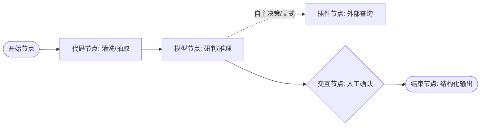

# 恒脑平台智能体开发指南（LLM精炼版）

> 本文档由原开发指南清洗提炼而成，剔除全部 UI 截图与操作流水账，仅保留工作流编排、节点配置、数据契约、API/MCP工具注册、RAG知识库规范及发布调用的核心开发规范。供大模型推理与方案设计高效消费。

---

## 1. 平台架构与运行环境边界

### 1.1 部署模式与网络边界
- **SaaS 模式 (`gc.das-ai.com`)**：
  - 核心特征：云端托管多租户服务。
  - **网络硬性约束**：智能体中配置的 API 工具（HTTP 插件）发起端位于**云端服务器**。所有被调用的外部后端接口（如本地开发的 FastAPI、ClickHouse 代理、通知中间件等）**必须具备公网可达 URL**（公网 IP、公网域名，或通过 frp、ngrok 等内网穿透技术暴露）。`localhost` 或纯内网 IP 无法被云端调度器访问。
- **私有化部署模式**：部署于本地专用 GPU 服务器或一体机，调用流量可在企业内网封闭流转。

### 1.2 智能体分类体系与创建模式
| 智能体形态 | 编排模式 | 核心能力边界与挂载规则 | 适用场景 |
| :--- | :--- | :--- | :--- |
| **智能体应用** | 零代码 | 纯提示词驱动，直接挂载 API 工具和知识库。 | 简单单一业务、单轮问答。 |
| **智能体应用** | 低代码（工作流） | 图节点可视化编排。模型节点支持挂载 **API 工具插件** 和 **安全知识库**；**不支持**直接挂载子智能体。 | 包含清洗、多轮研判、分支逻辑的复杂业务流程。 |
| **智能体组合** | 零代码/低代码 | 基于已发布的独立智能体进行复合编排。模型节点仅支持调用 **子智能体**；**不支持**直接挂载插件和知识库。 | 跨专业领域的多 Agent 协同任务。 |

---

## 2. 低代码工作流节点规范（Workflow Engine）

工作流采用有向无环图（DAG）驱动，核心包含以下 8 类功能节点：

### 2.1 开始节点（Start Node）
- **拓扑约束**：工作流唯一入口节点，画布默认存在，不可删除；仅支持单向连接下一个执行节点；连接边**不支持配置条件分支**。
- **输入参数（Input Schema）**：
  - 默认参数：`input`（String 类型，默认保留）。
  - 支持扩展参数：String, Integer, Float, Number, Boolean, Array, Object, File, Files。
  - **约束**：`File` 与 `Files` 仅支持在最外层定义，其余基础类型与 Object 支持嵌套。
  - 参数属性：支持配置是否必填、默认值、参数语义描述（语义描述直接影响大模型解析精度）。
- **全局模型配置继承**：
  - 在开始节点设置的 Model 参数（Temperature、Max Tokens、提示词等）为全工作流的默认全局底模配置，下游模型节点默认继承，亦可单独覆盖。
- **深度思考与输出约束**：
  - **深度思考（Reasoning）**：开启后额外输出 `reasoning_content` 参数，记录推理链路。
  - **采样温度（Temperature）**：范围 `0.0 ~ 2.0`，默认 `0.0`（研判分析场景推荐 `<= 0.2` 保障确定性）。
  - **Max Tokens**：上限 `32000`，默认 `1024`。
  - **Guided Regex**：正则约束输出。**硬性限制**：不支持 `^` 和 `$` 锚点，不支持分组表达式，限制长度不超过 50。
  - **Guided JSON**：JSON Schema 强约束。必须完整声明 `{ "type": "object", "properties": {...}, "required": [...] }`，`required` 字段禁止为空列表。
- **高级配置**：
  - 历史会话轮数：默认 `5` 轮（需配合节点“是否使用历史对话记录”开关）。

### 2.2 模型节点（LLM Node）
- **输入参数**：默认接收前置节点的输出 `result_key`，支持变量引用（`{{node_name.var}}`）和静态模板渲染。
- **挂载能力**：
  - 插件配置：挂载已注册且调试通过的 API 工具能力项，模型根据 Prompt 与描述**自主判断**是否调用。
  - 知识库配置：挂载已创建的 RAG 知识库，模型根据语义自动召回关联切片。
- **循环迭代（Loop Execution）**：
  - 针对 Array 类型入参进行批处理。
  - 迭代参数填 `0` 表示按传入数组的实际长度迭代。默认迭代上限 10 次，**平台硬性上限 32 次**。
- **输出参数提取**：
  - 默认输出：`result_key`（String；迭代模式下为 Array<String>）。
  - 自定义参数提取机制：支持通过 **JSONPath**（如 `$.data.attack_ip`）或 **正则表达式** 从大模型输出中抽取特定结构化字段。

### 2.3 插件节点（Plugin Node）
- **核心定位**：确定性、显式调用指定的 API 工具能力项（不依赖大模型自主选择）。
- **前置准入条件**：所选 API 工具必须在平台管理端完成连通性调试且状态为“成功”，未调试或调试失败的能力在节点选择器中置灰不可选。
- **参数映射**：将工作流上游变量直接映射到 API 请求的 `query`、`path`、`header` 或 `body` 中。
- **输出提取**：支持原生响应对象、`result_key` 或通过 JSONPath 提取子字段。支持 Array 循环迭代（最大 32 次）。

### 2.4 代码节点（Code Node）
- **运行环境**：支持 **Python** 与 **JavaScript**。
- **核心职责**：
  - 替代外部笨重的流处理引擎（如 Flink/Kafka），在平台内完成字段提取、白名单过滤、正则清洗。
  - 拼装外部 API 复杂的请求体结构，解析外部系统返回的异构数据。
- **参数协议**：
  - 输入：通过字典/参数映射接收前置节点变量。
  - 输出：代码必须将最终清洗或计算结果输出到返回字典中，默认输出为 `result_key`。
  - 亦支持循环迭代机制（最大 32 次）。

### 2.5 交互节点（Interactive Node / 人工确认）
- **双向交互机制**：专用于安全高危动作（如封禁 IP、隔离主机）前的人工阻断与审批。
- **功能分支 1：自定义消息输出**
  - 向前端输出阶段性处理信息（支持流式）。
  - **数据流特性**：该节点本身无独立数据输出，工作流继续向下传递时，默认透传该交互节点前置节点的执行结果。
- **功能分支 2：问答审批中断**
  - 挂起工作流引擎，等待用户交互输入后再继续向下执行。
  - **命名约束**：问题变量名仅限英文字母、数字和下划线，且**首字符不能为数字**。
  - **支持组件类型**：填空题、单选题、多选题、单文件上传、多文件上传。
  - **暴露输出变量**：
    - `{问题名}_question`：问题文本
    - `{问题名}_options`：选项列表
    - `{问题名}.answer`：用户的输入/审批选择结果
  - **外部驱动方式**：在外部自动化集成时，可通过开放服务 API `/open/api/v2/agent/execute/resume` 回传用户回答，解除中断继续执行。

### 2.6 自规划节点（Planner Node）
- **核心定位**：自主制定执行路径的多步思考规划单元。
- **硬性约束**：基座模型最大上下文长度 **必须 >= 128K**。
- **挂载工具**：绑定已注册的 MCP 工具与 Skills 技能。
- **执行保障**：支持配置最大节点执行超时时间及异常兜底分支。

### 2.7 智能体节点（Agent Node）
- **核心定位**：调用已发布的子智能体，实现分层化研判。
- 仅能调用处于“已发布”状态的智能体；支持输入参数绑定与结果提取；支持迭代执行（上限 32 次）。

### 2.8 结束节点（End Node）
- **拓扑约束**：工作流唯一终止节点，连接边不支持条件配置。
- **回答内容（Answer Presentation）**：配置用户端对话框可见的最终 Markdown 渲染文本（默认引用上游 `result_key`）。
- **结构化输出参数（Structured Outputs）**：
  - 定义外部调用接口（API）所获取的最终数据字典。
  - **特点**：该参数在 Web 对话界面不展示，但在外部通过开放 API 调用智能体时，将作为响应体中的 `results` 对象返回。
  - 支持绑定 `File` / `Files` 文件变量。

---

## 3. 数据流转与变量语法

工作流节点间依靠统一的上下文变量空间进行数据传递：

1. **默认传递键**：各节点默认将计算输出写入 `result_key`。
2. **变量赋值方式**：
   - **输入（Static）**：直接填写字面量字符串、数值或静态 JSON。
   - **引用（Reference）**：直接绑定上游某节点的输出字段（如 `code_node.clean_log`）。
   - **渲染（Template Rendering）**：采用模板占位符插入变量，如 `研判目标IP为：{{start_node.target_ip}}`。
3. **结构化提取规则**：
   - **JSONPath**：用于从上游 JSON 字典或数组抽取特定路径，格式如 `$.results.data[0].id`。
   - **正则表达式提取**：用于非结构化文本字段的正则模式截取。

---

## 4. API 工具（外部 HTTP 插件）接入规范

API 工具用于将外部 HTTP 服务封装为智能体可调用的插件。

### 4.1 层次结构与基础信息
- **API 工具集**：逻辑分组容器（如“日志与处置中间件服务”），可统一配置公共请求地址（Base URL）。
- **API 能力项（Action）**：具体的 RESTful 接口定义。

### 4.2 能力项核心元数据（直接影响大模型调度准确性）
- **能力名称 & 能力描述**：模型决定是否选用该接口的核心依据，必须清晰表达功能范围与使用场景。
- **请求方法**：仅支持 **GET** 和 **POST**。
- **请求头（Headers）**：配置认证标头（如 `Authorization: Bearer <token>`）、`Content-Type` 等。
- **返回文件类型**：
  - 开启：按二进制/文件规范接收（参数名默认 `file`，类型 `UFile`）。
  - 关闭：按标准 RESTful JSON 格式解析。

### 4.3 输入参数规范
| 字段 | 说明与约束 |
| :--- | :--- |
| **参数位置** | **query**（URL查询参数）、**path**（路径占位符如 `{ip}`）、**header**（请求头）、**body**（POST JSON体）。 |
| **参数类型** | String, Integer, Number, Float, Boolean, Array, Object, File。 |
| **参数名称 & 说明** | 大模型依据参数名称与描述自动生成请求实参，描述需详细说明取值规范与业务含义。 |
| **样例值** | 必填，用于平台侧联通性测试与参数校验。 |
| **是否必填** | 声明该字段是否必须存在。 |

### 4.4 调试准入机制（Hard Requirement）
- **强约束规则**：API 能力项配置完毕后，**必须在配置页面点击“调试”并返回成功状态**。
- 调试未运行或调试失败的能力项，在智能体编排工作流中将被强制置灰，**无法被任何模型节点或插件节点选用**。

---

## 5. 安全知识库（RAG）技术规格

| 配置维度 | 文本型知识库 | 问答对（FAQ）知识库 |
| :--- | :--- | :--- |
| **核心机制** | 通用长文本分块，向量化后匹配查询相似度。 | 严格按问答模板切分，按行向量化，精准匹配问题。 |
| **文件容量限制** | 单知识库不超过 **20 个文件**；单文件不超过 **100MB**。 | 同左。 |
| **支持格式** | doc, docx, pdf, json, txt, xls, xlsx, ppt, pptx。 | 需下载专用 Excel/表格模板填写上传。 |
| **分块策略** | **分块大小**（256~1024，默认 512）与 **自定义分隔符** **二选一互斥配置**。 | 按条目/行切分，不适用常规分块策略。 |
| **多模态** | 支持“是否理解图片内容”开关（开启后执行 OCR/图文联合解析）。 | 不支持。 |
| **状态流转** | 未开始 $\rightarrow$ 索引中 $\rightarrow$ 已就绪（就绪后方可挂载使用）/ 失败。 | 同左。 |

---

## 6. 智能体发布与对外集成生命周期

### 6.1 发布生效规则
1. **未发布状态（“我的创建”）**：仅能在 Web 工作台内部调试，**不具备外部调用能力**。
2. **发布状态（已发布）**：
   - 触发平台生成唯一的 **智能体 ID（Agent ID）**。
   - 仅当智能体处于“已发布”状态时，方可被外部系统通过 Open API 调用，或被其他智能体作为子节点调用。
   - 发布范围支持：同租户可见、完全公开、受限公开。

### 6.2 开放服务（Open API）外部调用协议
- **通用鉴权 Headers**：
  - `appKey`：应用标识。
  - `sign`：HMAC-SHA256 签名凭证，计算公式：
    $$\text{sign} = \text{timestamp} + \text{Base64}\Big(\text{HMAC-SHA256}\big(\text{timestamp},\; \text{appSecret}\big)\Big)$$
- **执行接口**：
  - 接口：`POST /open/api/v2/agent/execute`
  - 入参：`{ "agent_id": "...", "input": {...} }`
  - 返回：包含对话流输出、消耗的 `token_usage` 以及在工作流【结束节点】配置的结构化 `results` 字段。
- **交互节点恢复接口**：
  - 接口：`POST /open/api/v2/agent/execute/resume`
  - 用于外部程序在人工审批完成后，向被交互节点挂起的工作流注回应答内容，恢复执行链路。