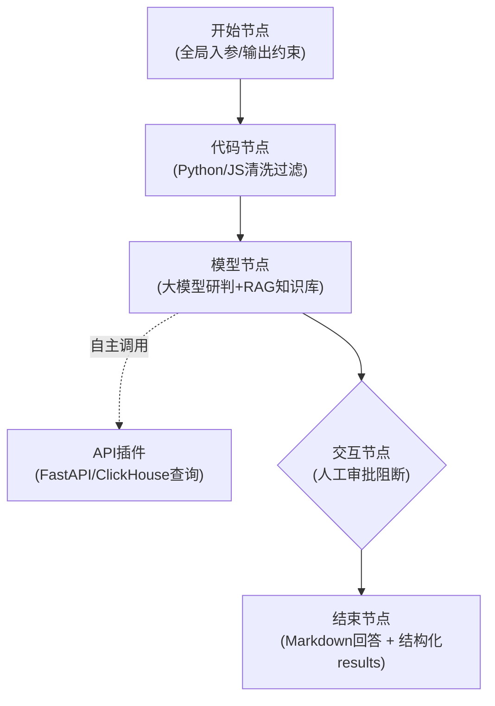

# 恒脑平台核心开发参考手册（LLM高密度版）

> **文档用途**：本文档为恒脑安全智能体开发应用平台的纯技术规格说明书，消除所有 UI 截图与操作流水账，为大模型推理、工作流编排设计及前后端协同提供统一的数据契约、节点规范与约束边界。

---

## 一、 平台定位与网络通信约束

1. **环境与调用方向**：
   - 恒脑平台主要运行于公网 SaaS 环境（`gc.das-ai.com`）。
   - **通信约束（咽喉要道）**：平台上的“API 工具/插件节点”是从**云端向外部服务发起 HTTP/HTTPS 请求**。
   - **网络要求**：所有由本地维护的自建服务（如 FastAPI 工具层、ClickHouse 代理、处置 Mock 等）**必须具有公网可达地址**（公网 VPS、云主机或 frp / ngrok 等内网穿透隧道）。禁止配置 `localhost` 或纯局域网私网 IP。
2. **智能体形态**：
   - **智能体应用（单一流程）**：支持低代码工作流，模型节点可直接挂载**API 工具插件**和**RAG 知识库**；不支持挂载子智能体。
   - **智能体组合（多智能体协同）**：模型节点仅支持调用已发布的**子智能体**；不支持直接挂载底层插件与知识库。

---

## 二、 低代码工作流节点规范（Workflow Engine）

工作流由标准有向图（DAG）驱动，核心包含以下 8 种节点类型：



### 1. 开始节点（Start Node）
- **拓扑特性**：工作流唯一初始节点，不可删除；仅能单向连接一个入口节点；连接边不支持配置条件分支。
- **输入参数（Input Schema）**：
  - 默认参数 `input`（String 类型）。
  - 支持扩展参数类型：`String`, `Integer`, `Float`, `Number`, `Boolean`, `Array`, `Object`, `File`, `Files`。
  - **嵌套约束**：`File` 与 `Files` 仅支持在最外层声明，其余类型均支持深层嵌套。
  - 参数元数据：包含名称、语义描述（影响大模型解析）、默认值、是否必填。
- **全局模型配置与输出约束**：
  - `Temperature`：`0.0 ~ 2.0`（默认 `0.0`，研判推理场景建议 `<= 0.2`）。
  - `Max Tokens`：上限 `32000`，默认 `1024`。
  - `Top_k` / `Top_p`：默认 `-1` / `1.0`。
  - `是否开启思考`：开启后输出 `reasoning_content`，保存思维链（CoT）。
  - `Guided Regex`（正则输出约束）：**不支持 `^` 和 `$`，不支持分组表达式，限制长度 `<= 50`**。
  - `Guided JSON`（JSON Schema强约束）：必须显式声明完整 Schema，如 `{"type": "object", "properties": {...}, "required": [...]}`，`required` 列表禁止为空。
- **会话配置**：历史会话轮数默认 `5` 轮。

### 2. 模型节点（LLM Node）
- **输入参数**：默认接收前一节点的输出 `result_key`，支持变量引用与模板渲染。
- **挂载能力**：
  - API 插件：大模型根据 Prompt 与工具语义描述自主决策是否触发。
  - RAG 知识库：根据 Prompt 上下文自动召回向量化知识。
- **循环迭代（Loop）**：
  - 支持对 `Array` 变量按项循环执行；填 `0` 代表按数组长度迭代。
  - **平台硬性限制**：默认上限 10 次，**最大上限 32 次**。
- **输出抽取**：默认返回 `result_key`（String；迭代模式下为 Array<String>）。支持配置自定义参数，使用 **JSONPath**（如 `$.data.result[0]`）或 **正则表达式** 精确提取结构化字段。

### 3. 插件节点（Plugin Node）
- **确定性调用**：用于显式、必须执行的外部 HTTP 请求，不依赖模型自主推理。
- **准入条件（硬约束）**：API 工具必须在平台调试通过（状态为“成功”），否则节点无法选中该能力项。
- **输入映射**：将工作流变量绑定至目标 API 的 `query`、`path`、`header` 或 `body`。
- **输出提取**：原样接收响应体，支持 `result_key`、能力项原生字段或 JSONPath 自定义抽取。支持 Array 循环迭代（最大 32 次）。

### 4. 代码节点（Code Node）
- **运行环境**：支持 **Python** 与 **JavaScript**。
- **定位**：轻量级数据处理引擎，负责复杂正则抽取、日志结构标准化、白名单放行过滤、接口参数二次装配。
- **参数流转**：输入参数通过变量字典传入，执行结果必须 return 字典对象，默认输出键为 `result_key`。支持 Array 循环迭代（最大 32 次）。

### 5. 交互节点（Interactive Node / 人工确认）
- **核心机制**：用于高危动作（封 IP、下线服务）前的人工阻断与审批。
- **模式 A - 消息输出**：流式推送阶段性提示，该节点不产生独立数据，执行结果默认透传前置节点的返回值。
- **模式 B - 问答中断（Approval Gate）**：
  - 阻断工作流，等待用户提交后继续。
  - **命名规范**：仅限字母、数字、下划线，**首字符禁止为数字**。
  - **支持类型**：填空、单选、多选、单文件、多文件。
  - **暴露变量**：`{问题名}_question`、`{问题名}_options`、`{问题名}.answer`。
  - **外部驱动接口**：支持外部系统通过 Open API `/open/api/v2/agent/execute/resume` 提交选项并恢复工作流。

### 6. 自规划节点（Planner Node）
- **核心机制**：由大模型自主分解多步骤子任务并规划执行。
- **硬性约束**：基座模型最大上下文窗口 **必须 >= 128K**。
- **绑定能力**：仅支持挂载 **MCP 工具** 与 **Skills 技能**。

### 7. 智能体节点（Agent Node）
- **嵌套调用**：支持调用同租户或广场已发布的其他智能体，实现分层化研判架构。支持 Array 循环迭代（最大 32 次）。

### 8. 结束节点（End Node）
- **拓扑特性**：工作流唯一终止出口，连接边不支持条件配置。
- **回答内容（Answer Presentation）**：配置前端对话框渲染的 Markdown 文本（默认引用上游 `result_key`）。
- **结构化输出参数（Structured Results）**：
  - 页面对话框不可见，专供外部 API 调用消费。
  - 在 Open API 的响应报文中原样封装于 `results` 字典中返回。支持 `File` / `Files` 文件流变量。

---

## 三、 数据流转与变量语法

1. **节点间默认变量**：各节点默认计算输出均挂载在 `result_key` 上。
2. **三类取值语法**：
   - **输入（Literal）**：静态常量字符串、数值、固定 JSON。
   - **引用（Reference）**：直接绑定前序节点输出（如 `code_cleaner.parsed_ip`）。
   - **渲染（Template）**：字符串插值，如 `待研判的源IP为：{{start.src_ip}}，告警类型：{{start.alert_name}}`。
3. **结构化提取规范**：
   - **JSONPath**：用于从 JSON 对象抽取嵌套字段，如 `$.data.alerts[*].id`。
   - **正则表达式提取**：用于从大模型或代码节点的纯文本输出中截取特定 Pattern。

---

## 四、 API 工具（HTTP 插件）接入协议规范

外部服务（如 FastAPI 中间件）接入恒脑平台必须遵守以下协议规范：

1. **工具集与能力项**：
   - 工具集：逻辑分组，配置统一 Base URL（如 `https://api.yourdomain.com`）。
   - 能力项：具体 URL 路径（如 `/query_logs`）。
2. **请求方法**：支持 **GET** 与 **POST**。
3. **参数位置（Param Location）**：
   - `query`：追加在 URL 后的查询参数（`?k=v`）。
   - `path`：动态 URL 路径占位（`/alerts/{id}`）。
   - `header`：自定义请求头（如认证 Token）。
   - `body`：请求体（POST JSON）。
4. **参数类型**：`String`, `Integer`, `Number`, `Float`, `Boolean`, `Array`, `Object`, `File`。
5. **平台调试强约束（重要踩坑点）**：
   - 在平台保存 API 工具前，**必须填写样例值并点击“调试”且返回 HTTP 200**。
   - 调试失败或未调试的能力项，在工作流的模型节点和插件节点中处于置灰状态，**无法选择**。
6. **语义提示质量**：
   - 能力项的“能力名称”与“能力描述”，以及输入参数的“参数说明”，是大模型理解和构造 HTTP 请求的唯一依据。描述需包含业务含义、格式要求及枚举值。

---

## 五、 安全知识库（RAG）技术规格

| 项目 | 文本型知识库 | 问答对（FAQ）知识库 |
| :--- | :--- | :--- |
| **主要定位** | 通用研判基准、ATT&CK 战术、处置规范文档 | 标准 CVE 处置卡片、高频误报 FAQ 规则库 |
| **文件容量上限** | 单知识库 $\le 20$ 个文件；单文件 $\le 100\text{ MB}$ | 单知识库 $\le 20$ 个文件；单文件 $\le 100\text{ MB}$ |
| **支持文件格式** | `doc`, `docx`, `pdf`, `json`, `txt`, `xls`, `xlsx`, `ppt`, `pptx` | 平台专用 Excel/表格模板 |
| **分块策略** | **分块大小（256~1024，默认 512）与自定义分隔符互斥二选一** | 按表格条目/行切分 |
| **图片识别** | 支持开启 OCR / 图片内容理解 | 不支持 |
| **状态生命周期** | 未开始 $\rightarrow$ 索引中 $\rightarrow$ 已就绪（必须就绪方可挂载）/ 失败 | 未开始 $\rightarrow$ 索引中 $\rightarrow$ 已就绪 / 失败 |

---

## 六、 开放服务（Open API）外部调用契约

### 1. 鉴权认证协议
- **HTTP Header**：
  - `appKey`：应用标识。
  - `sign`：HMAC-SHA256 签名。
  - `Content-Type`：`application/json`。
- **签名算法**：
  $$\text{sign} = \text{timestamp} + \text{Base64}\Big(\text{HMAC-SHA256}\big(\text{timestamp},\; \text{appSecret}\big)\Big)$$
  - `timestamp`：13 位当前毫秒级时间戳。

### 2. 核心接口清单
1. **同步执行智能体**：
   - `POST /open/api/v2/agent/execute`
   - 入参：`{ "agent_id": "xxx", "input": { ... } }`
   - 返回：
     ```json
     {
       "code": 200,
       "data": {
         "session_id": "sess-xxxx",
         "reply": "最终展示Markdown文本",
         "results": { /* 结束节点定义的结构化输出字典 */ },
         "token_usage": { "total_tokens": 1500 }
       }
     }
     ```
2. **交互恢复（人工审批提交）**：
   - `POST /open/api/v2/agent/execute/resume`
   - 入参：`{ "session_id": "sess-xxxx", "action": "confirm", "answers": { "agree": true } }`
3. **异步长任务流**：
   - 提交任务：`POST /open/api/v2/agent/task/submit`
   - 轮询状态：`GET /open/api/v2/agent/task/status?task_id=xxx`
   - 获取结果：`GET /open/api/v2/agent/task/messages?task_id=xxx`
4. **文件处理**：
   - 上传文件：`POST /open/api/v2/agent/file/upload`
   - 下载文件：`GET /open/api/v2/agent/file/download?file_id=xxx`

---

## 七、 平台技术边界与避坑 Checklist

1. **网络联通性**：恒脑为云端 SaaS，本地 FastAPI / ClickHouse 必须在第 1 周通过 frp / 云主机配通公网 URL，并在平台 API 工具界面调试成功。
2. **发布状态约束**：智能体在“我的创建”草稿状态下**没有全局 Agent ID**，无法被 Open API 或其他智能体调用；必须点击“发布”后生成的 `agent_id` 才有效。
3. **高危阻断策略**：自动封禁、阻断等高危处置动作，**必须前置挂载【交互节点】**，通过页面人工确认或外部系统调用 `/execute/resume` 触发，严禁模型直接无审批连通封禁插件。
4. **大输入与时延控制**：
   - 全链路（LLM + RAG + ClickHouse检索 + SMTP）耗时预计在 10~30s 之间。
   - 答辩或高频请求场景，可通过代码节点设置快速分流旁路，跳过非必要的外部慢查询。
